# Java Collections Challenge

## 1. Project Overview

The **Java Collections Challenge** is a menu-driven console application developed using Java.

The project demonstrates the practical implementation of three important components of the Java Collections Framework:

- ArrayList
- HashMap
- Queue

The application provides three modules to manage book titles, student marks, and customer service queues.

Each module is implemented in a separate Java class to maintain code organization, readability, and separation of responsibilities.

## 2. Project Objectives

- Understand and implement the Java Collections Framework.
- Manage dynamic data using ArrayList.
- Store and retrieve key-value pairs using HashMap.
- Understand FIFO (First In, First Out) processing using Queue.
- Practice object-oriented programming concepts.
- Implement input validation and exception handling.
- Develop a menu-driven Java application using multiple classes.

## 3. Features and Functionalities

### 3.1 ArrayList – Book Manager

The ArrayList module manages a dynamic collection of book titles.

**Features:**

- Add new books.
- Display all available books.
- Search for a book by title.
- Update an existing book title.
- Remove a book from the list.
- Validate empty book titles.
- Handle invalid menu choices and book numbers.

**Collection used:** `ArrayList<String>`

**Important methods:**

| Method | Description |
|---|---|
| `add()` | Adds a book to the list |
| `get()` | Retrieves a book using its index |
| `set()` | Updates an existing book |
| `remove()` | Removes a book |
| `contains()` | Checks whether a book exists |
| `size()` | Returns the number of books |

### 3.2 HashMap – Student Marks Manager

The HashMap module stores student records using student IDs as keys and marks as values.

**Features:**

- Add student ID and marks.
- Retrieve student marks using student ID.
- Update existing student marks.
- Check whether a student ID exists.
- Display all student records.
- Prevent duplicate student IDs.
- Validate marks between 0 and 100.
- Handle invalid numeric input and missing records.

**Collection used:** `HashMap<Integer, Double>`

**Important methods:**

| Method | Description |
|---|---|
| `put()` | Inserts or updates a key-value pair |
| `get()` | Retrieves a value using its key |
| `containsKey()` | Checks whether a key exists |
| `entrySet()` | Returns all key-value entries |
| `isEmpty()` | Checks whether the map is empty |

**Example:**

```java
students.put(101, 85.0);

System.out.println(students.get(101));
```

Output:

```text
85.0
```

### 3.3 Queue – Customer Token System

The Queue module simulates a customer service token system.

Customers are added to the queue and served in the order in which they arrive.

**Features:**

- Add customers to the queue.
- Serve the next customer.
- View the next customer without removing them.
- Display all waiting customers.
- Handle an empty queue.

**Collection used:** `Queue<String>` implemented using `LinkedList<String>`.

**Important methods:**

| Method | Description |
|---|---|
| `offer()` | Adds a customer to the queue |
| `poll()` | Removes and returns the next customer |
| `peek()` | Retrieves the next customer without removing them |
| `isEmpty()` | Checks whether the queue is empty |

**FIFO Example:**

```text
Customer Queue:
1. Suraj
2. Bob
3. Alice

Now serving: Suraj
Now serving: Bob
Next customer: Alice
```

This demonstrates the First In, First Out (FIFO) principle.

## 4. Technologies Used

| Technology | Purpose |
|---|---|
| Java | Application development |
| Java Collections Framework | Data management |
| ArrayList | Dynamic list management |
| HashMap | Key-value data storage |
| Queue | FIFO processing |
| LinkedList | Queue implementation |
| Scanner | User input |
| Visual Studio Code | Development environment |
| JDK | Compilation and execution |

## 5. Project Structure

```text
JavaCollectionsChallenge/
│
├── src/
│   ├── ArrayListManager.java
│   ├── HashMapManager.java
│   ├── QueueManager.java
│   └── Main.java
│
├── ScreenShots/
│   │
│   ├── ArrayList/
│   │   ├── ArrayList-AddBook.jpg
│   │   ├── ArrayList-BackToMenu.jpg
│   │   ├── ArrayList-Menu.jpg
│   │   ├── ArrayList-Remove.jpg
│   │   ├── ArrayList-Search.jpg
│   │   └── ArrayList-Update.jpg
│   │
│   ├── HashMap/
│   │   ├── HashMap-Add.jpg
│   │   ├── HashMap-Back.jpg
│   │   ├── HashMap-Check.jpg
│   │   ├── HashMap-Display.jpg
│   │   ├── HashMap-Menu.jpg
│   │   ├── HashMap-Retrive.jpg
│   │   └── HashMap-Update.jpg
│   │
│   ├── Queue/
│   │   ├── Queue-Add.jpg
│   │   ├── Queue-BackToMenu.jpg
│   │   ├── Queue-Display.jpg
│   │   ├── Queue-Menu.jpg
│   │   ├── Queue-Peek.jpg
│   │   └── Queue-Remove.jpg
│   │
│   ├── ArrayList-Menu.jpg
│   ├── Exit.jpg
│   ├── HashMap-Menu.jpg
│   ├── Main-Menu.jpg
│   └── Queue-Menu.jpg
│
├── README.md
└── out/                 (Generated during compilation)
```

## 6. Application Architecture

The application is organized into four Java classes.

| Class | Responsibility |
|---|---|
| `Main.java` | Displays the main menu and controls navigation |
| `ArrayListManager.java` | Handles book management operations |
| `HashMapManager.java` | Handles student record operations |
| `QueueManager.java` | Handles customer queue operations |

### Application Flow

1. The application starts from the `main()` method in `Main.java`.
2. The main menu displays the three collection modules.
3. The user selects a module.
4. The corresponding manager class performs the requested operation.
5. The user can return to the main menu or exit the application.

## 7. How to Compile and Run

### Prerequisites

- Java Development Kit (JDK 8 or later).
- Visual Studio Code or another Java-compatible editor.
- Java configured in the system PATH.

### Step 1: Open the project directory

Open PowerShell and navigate to the project folder:

```powershell
cd D:\WeIntern\JavaCollectionsChallenge
```

### Step 2: Compile the Java source files

Run the following command:

```powershell
javac -d out src\*.java
```

This command compiles all Java source files and stores the generated `.class` files inside the `out` directory.

### Step 3: Run the application

```powershell
java -cp out JavaCollectionsChallenge.Main
```

The application will display the main menu in the terminal.

## 8. Application Menu

The main menu provides access to all three collection modules.

```text
================================
     JAVA COLLECTIONS CHALLENGE
================================
1. ArrayList - Book Manager
2. HashMap - Student Marks Manager
3. Queue - Customer Token System
4. Exit
================================
Enter your choice:
```

### Available Options

- Option 1: Open the Book Manager.
- Option 2: Open the Student Marks Manager.
- Option 3: Open the Customer Token System.
- Option 4: Exit the application.

## 9. Input Validation and Exception Handling

Input validation is implemented to prevent invalid operations and improve application reliability.

The application handles the following situations:

- Empty book titles are rejected.
- Empty customer names are rejected.
- Invalid menu choices are handled.
- Non-numeric input where an integer is expected is handled using `NumberFormatException`.
- Duplicate student IDs are rejected.
- Student marks below 0 or above 100 are rejected.
- Invalid book numbers are rejected.
- Missing student records are handled.
- Empty queues are handled without attempting to serve a customer.

These validations help the application handle unexpected user input without terminating unexpectedly.

## 10. Testing

The application was compiled and executed successfully using PowerShell.

The following functionalities were tested:

### ArrayList Testing

- Adding multiple books.
- Displaying all books.
- Searching for existing and non-existing books.
- Updating book titles.
- Removing books.
- Rejecting empty book titles.
- Handling invalid menu input.

### HashMap Testing

- Adding student records.
- Retrieving marks using student IDs.
- Updating student marks.
- Checking whether student IDs exist.
- Displaying all student records.
- Rejecting duplicate student IDs.
- Rejecting marks outside the valid 0–100 range.
- Handling non-existing student records.

### Queue Testing

- Adding multiple customers.
- Displaying waiting customers.
- Serving customers in FIFO order.
- Viewing the next customer using `peek()`.
- Displaying the updated queue after serving customers.

### Main Menu Testing

- Navigating between all three modules.
- Returning to the main menu.
- Handling invalid menu choices.
- Handling non-numeric menu input.
- Exiting the application.

## 11. Screenshots

Screenshots of the application execution and tested functionalities are included in the `ScreenShots` directory.

### 11.1 Main Application

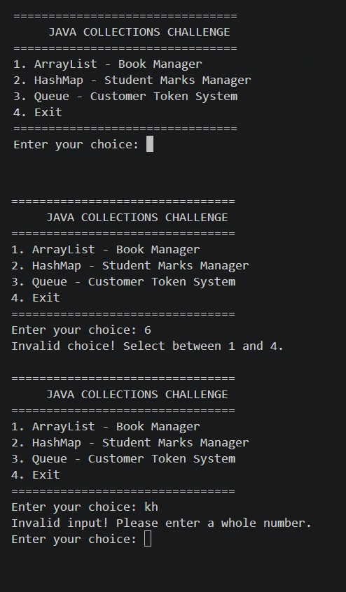

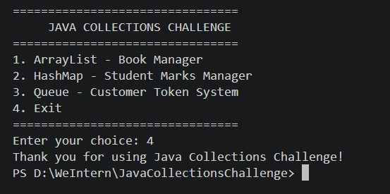

### 11.2 ArrayList – Book Manager

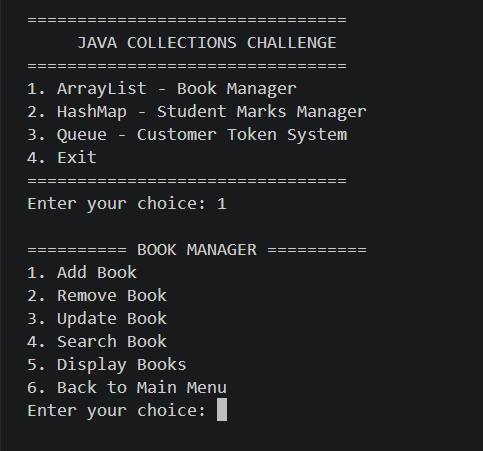

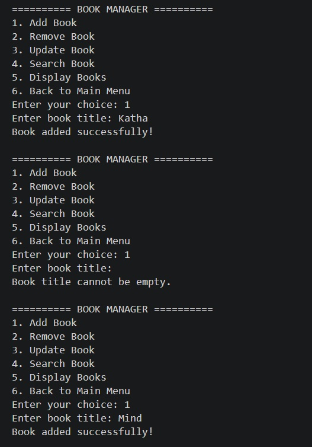

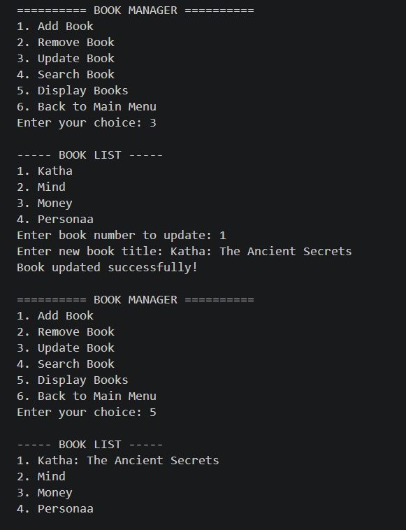

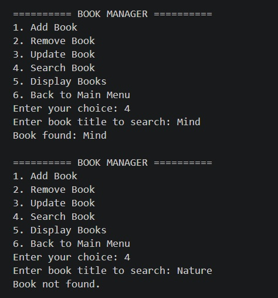

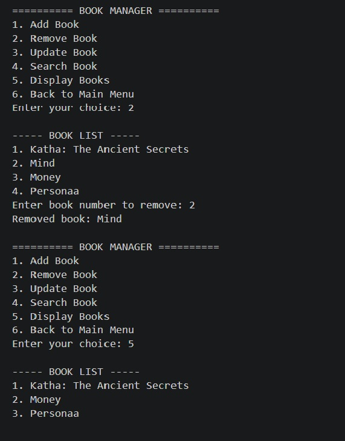

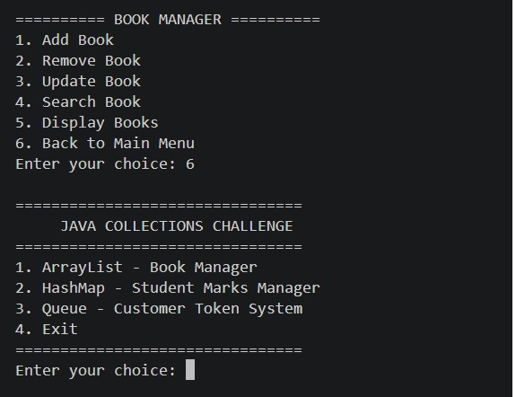

### 11.3 HashMap – Student Marks Manager

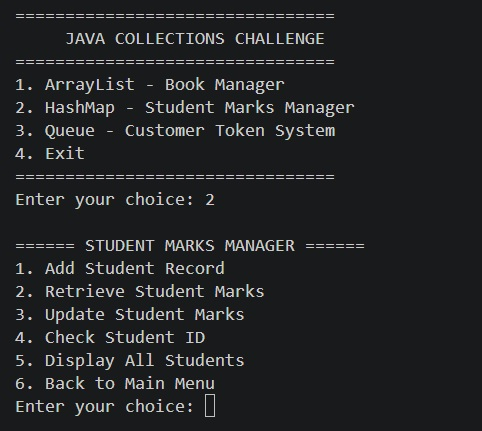

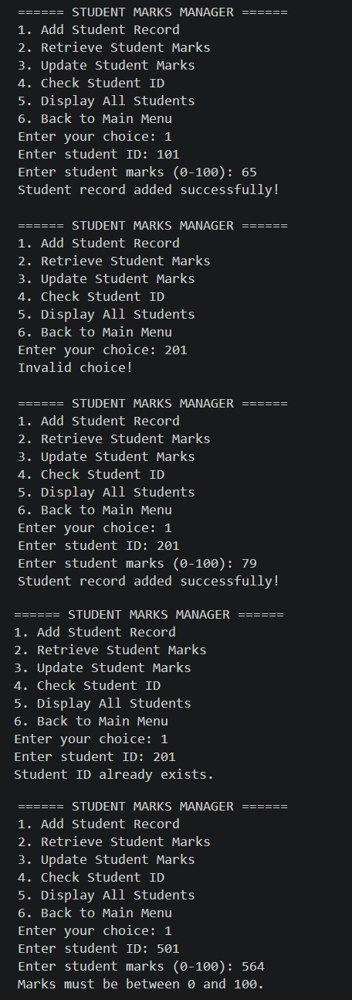

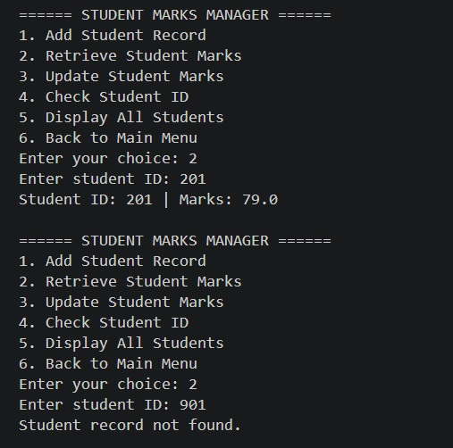

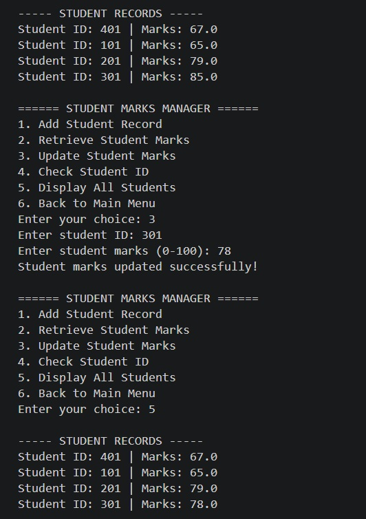

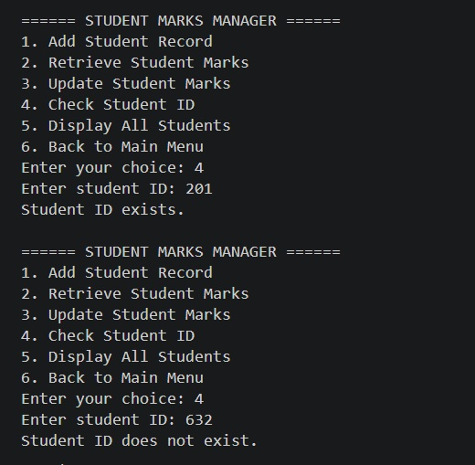

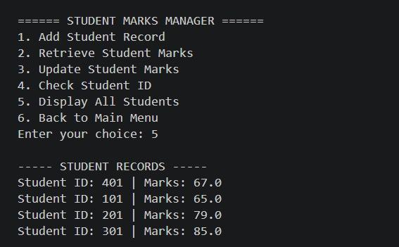

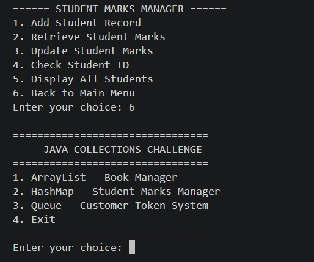

### 11.4 Queue – Customer Token System

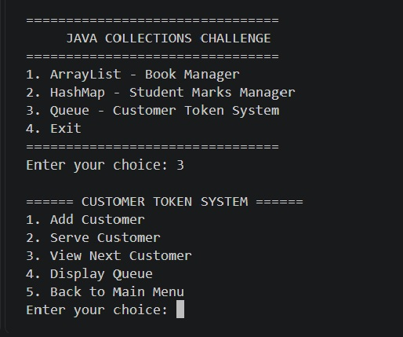

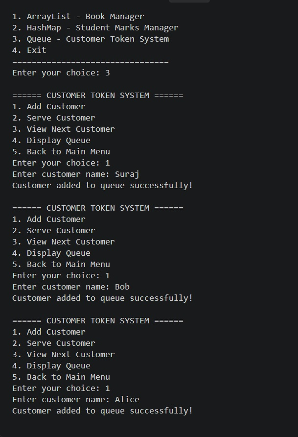

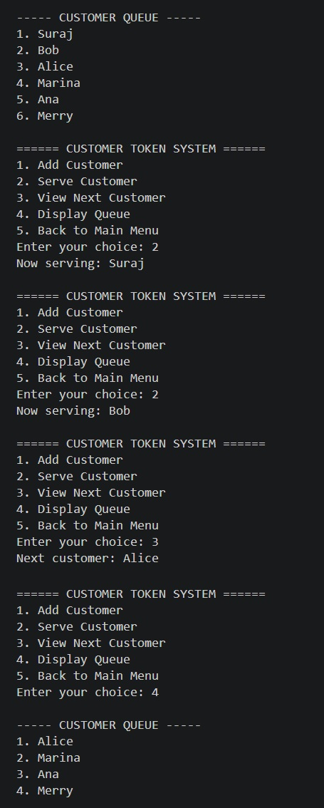

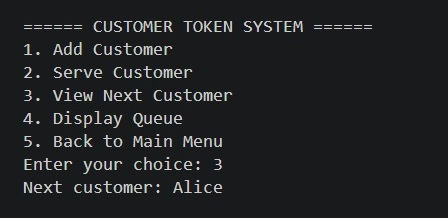

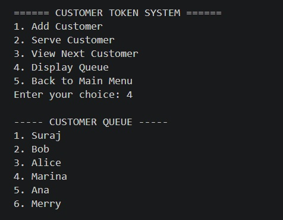

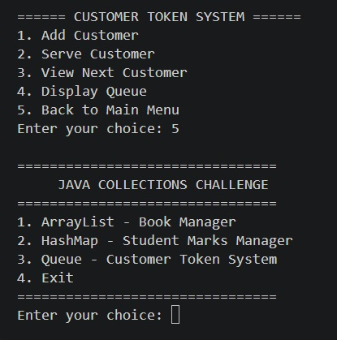

## 12. Learning Outcomes

Through this assignment, I gained practical experience in:

- Understanding and implementing the Java Collections Framework.
- Managing dynamic data using ArrayList.
- Working with key-value pairs using HashMap.
- Implementing FIFO operations using Queue.
- Understanding collection methods and iteration.
- Applying object-oriented programming principles.
- Using constructors and private instance variables.
- Implementing input validation and exception handling.
- Organizing Java programs into multiple classes.
- Compiling and executing Java applications through PowerShell.

## 13. Future Enhancements

Possible improvements for this project include:

- Add persistent storage using file handling.
- Introduce a graphical user interface.
- Add additional search and sorting features.
- Store student and book information in a database.
- Introduce additional collection types such as HashSet and TreeMap.

## 14. Author

Suraj Naikwade